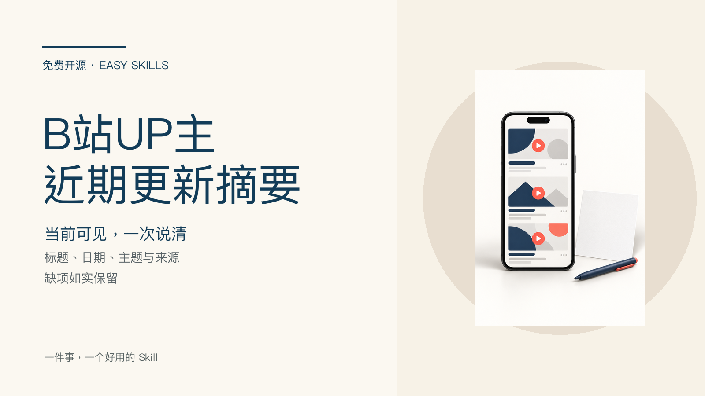

# Bilibili Channel Update Digest

Turn up to 10 videos currently visible on a specified Bilibili creator page into a traceable update digest. Provide one connected `browserId` and the creator-page URL; the result contains title, displayed date, topic, link, per-item source, and omissions. Missing dates stay blank—this Skill never invents upload times or view counts.



## Input and result

Input: one explicit `browserId`, one creator-page URL, and a limit of up to 10 currently visible videos.

Result: a copyable Markdown table with title, date, topic, link, visible source, and limits. It is a one-off digest, not monitoring or private-analytics automation.

## Install

```bash
npx skills add xxjrq/bilibili-channel-update-digest-free
```

This browser Skill requires [Easy WebBridge on GitHub](https://github.com/xxjrq/easy-webbridge); use the [Gitee mirror](https://gitee.com/xxjrq/easy-webbridge) when needed. Choose one browser environment at runtime. Each run owns only its own session group and never takes over existing pages or other accounts.

## Validation

Run `node scripts/self-test.mjs`. Fixtures simulate offline page material only; they are not online collection results.

## License and reference

Published under [MIT](LICENSE). Business-use references: [OpenCLI](https://github.com/xxjrq/easy-webbridge) and its [Bilibili adapter](https://github.com/xxjrq/easy-webbridge/blob/main/docs/adapters/browser/bilibili.md). No implementation or text has been copied.
